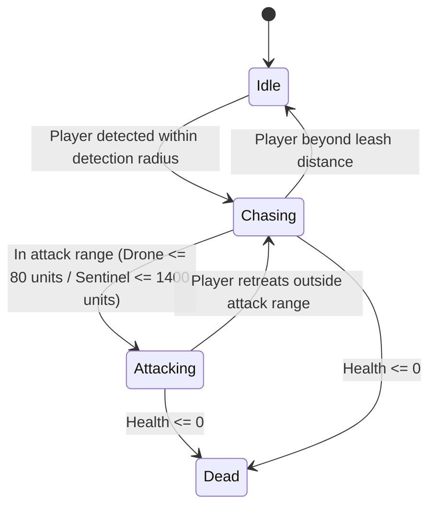

# Project VANGUARD: Technical Architecture & Core Algorithms

This document provides in-depth technical explanations of the algorithms, mathematical foundations, and rendering pipelines implemented in **FPSLabGame - Project VANGUARD**.

---

## 1. 2D Tile Arrays & Symbolic Tile Encodings

The entire game world across all three levels is defined using discrete 2D integer grids in [`src/LevelData.h`](file:///c:/Users/JOYDEEP/Desktop/FPSv8/qt%20project/src/LevelData.h). Each matrix cell represents a fixed world space volume of dimension $100 \times 100 \times 100\text{ units}$ (`GameConfig::BLOCK_SIZE`).

```cpp
namespace TileCode {
    constexpr int Empty              = 0; // Air / Open walkable floor
    constexpr int Wall               = 1; // Solid boundary wall (Height: 3 blocks)
    constexpr int Crate              = 2; // Metal shipping container obstacle (Height: 2 blocks)
    constexpr int PlayerSpawn        = 3; // Initial player spawn location (Floor)
    constexpr int Level1Exit         = 4; // Extraction elevator (Level 1 exit)
    constexpr int Level2Exit         = 6; // Descent shaft (Level 2 exit)
    constexpr int HeavyWeaponPickup  = 7; // The Cache: Plasma Repeater unlock (Level 2)
    constexpr int TriggerTrap        = 8; // Crossfire ambush trigger floor (Level 2)
    constexpr int CoreWall           = 9; // VANGUARD armored mainframe pillar (Height: 4 blocks)
}
```

* **Level 1 (`level1[32][32]`)**: Tight industrial maze with claustrophobic corridors and a $10 \times 10$ open Loading Bay.
* **Level 2 (`level2[64][64]`)**: Multi-wing Armory complex containing an isolated cache room, crossfire killzones, and automated defense turrets.
* **Level 3 (`level3[40][40]`)**: Open square arena with 4 corner cooling towers surrounding the central armored VANGUARD AI mainframe.

---

## 2. Converting 2D Grids to 3D Geometry: GPU Hardware Instancing

Rendering thousands of individual `Model` components in a 3D scene would saturate the CPU-to-GPU command pipeline with draw calls. To achieve a locked 60 FPS, Project VANGUARD implements hardware-accelerated instanced rendering via [`src/TileMapInstancing.h/.cpp`](file:///c:/Users/JOYDEEP/Desktop/FPSv8/qt%20project/src/TileMapInstancing.h), which inherits from `QQuick3DInstancing`.

### Implementation Pipeline:
1. `LevelManager::loadLevel(index)` parses the active 2D integer matrix.
2. For each block height layer ($h \in [0, \text{height}-1]$) and block type (`Wall`, `Crate`, `CoreWall`):
   - A 3D translation vector is calculated:  
     $$\vec{P} = \left( (\text{col} + 0.5) \cdot S,\; (h + 0.5) \cdot S,\; (\text{row} + 0.5) \cdot S \right)$$  
     where $S = 100.0\text{ units}$.
   - A $4 \times 4$ transformation matrix is packed into a binary `InstanceTableEntry`.
   - The instance buffer is uploaded directly to GPU VRAM via `createInstanceTable()`.
3. In [`qml/LevelView.qml`](file:///c:/Users/JOYDEEP/Desktop/FPSv8/qt%20project/qml/LevelView.qml), a single `#Cube` primitive model is bound to the instancing table:
   ```qml
   Model {
       source: "#Cube"
       instancing: wallInstancing
       materials: [ PrincipledMaterial { ... } ]
   }
   ```
**Result**: The GPU draws up to $1,500+$ textured blocks in a **single draw call**, eliminating CPU overhead.

---

## 3. Player Kinematics, Crouching, and Camera Architecture

Player motion is simulated in [`src/Player.cpp`](file:///c:/Users/JOYDEEP/Desktop/FPSv8/qt%20project/src/Player.cpp) using discrete integration over variable delta time ($\Delta t$).

* **Horizontal Movement**: Direction vectors are derived from camera yaw ($\theta$):
  $$\vec{F}_{\text{forward}} = \begin{pmatrix} \sin\theta \\ 0 \\ \cos\theta \end{pmatrix}, \quad \vec{F}_{\text{right}} = \begin{pmatrix} \cos\theta \\ 0 \\ -\sin\theta \end{pmatrix}$$
  Velocity is scaled by player movement state ($240\text{ units/s}$ walking, $120\text{ units/s}$ crouching).
* **Vertical Kinematics & Jumping**:
  $$v_y(t + \Delta t) = v_y(t) - g \cdot \Delta t \quad (g = 980\text{ units/s}^2)$$
  When grounded, pressing Space injects an upward impulse $v_y = 350\text{ units/s}$.
* **Crouching Height Lerp**:
  Eye height smoothly interpolates between standing ($150\text{ units}$) and crouching ($75\text{ units}$):
  $$H_{\text{eye}}(t + \Delta t) = \text{lerp}(H_{\text{eye}}, H_{\text{target}}, 14 \cdot \Delta t)$$
* **Camera Clamping**: Mouse delta directly controls pitch ($\phi \in [-89^\circ, +89^\circ]$) and unbounded yaw ($\theta \in [0^\circ, 360^\circ)$).

---

## 4. Ballistics & Digital Differential Analysis (DDA) Raycasting

When the player discharges the AK-47 Sniper Rifle or Heavy Plasma Cannon, collision testing must verify whether obstacles obstruct the shot before impacting enemies or cooling vents. Instead of expensive bounding volume hierarchies, [`src/Sniper.cpp`](file:///c:/Users/JOYDEEP/Desktop/FPSv8/qt%20project/src/Sniper.cpp) executes an exact **2D/3D Grid Digital Differential Analyzer (DDA)** algorithm.

### Mathematical Formulation:
Given ray origin $\vec{O} = (x_0, y_0, z_0)$ and normalized unit direction $\vec{D} = (d_x, d_y, d_z)$:
1. Calculate step direction: $\text{step}_x = \text{sgn}(d_x), \; \text{step}_z = \text{sgn}(d_z)$.
2. Calculate delta distances: $\Delta t_x = \left|\frac{S}{d_x}\right|, \; \Delta t_z = \left|\frac{S}{d_z}\right|$.
3. Calculate distance to first cell boundary:
   $$t_{\text{max}, x} = \frac{(\text{boundary}_x - x_0)}{d_x}, \quad t_{\text{max}, z} = \frac{(\text{boundary}_z - z_0)}{d_z}$$
4. Increment through the 2D grid stepping along whichever axis has the smaller $t_{\text{max}}$.
5. If the current tile contains a solid block (`Wall`, `Crate`, `CoreWall`), raycast terminates at wall hit distance $t_{\text{wall}}$.

### Hit Resolution Hierarchy:
1. Ray is tested against all active enemies (Cylinder hit test: distance along ray to enemy center $< \text{radius}$).
   - If distance $< t_{\text{wall}}$, enemy is hit!
   - Headshot: Hit height $y \in [110, 160]\text{ units} \implies \text{80 Damage}$.
   - Bodyshot: Hit height $y \in [0, 110]\text{ units} \implies \text{40 Damage}$.
2. Ray is tested against active Level 3 Cooling Vents ($150\text{ HP}$).
3. If no entity is intersected before $t_{\text{wall}}$, weapon produces impact sparks on the wall surface.

---

## 5. Enemy AI Finite State Machines (FSM)

Hostile automatons operate under an autonomous state machine in [`src/Enemy.cpp`](file:///c:/Users/JOYDEEP/Desktop/FPSv8/qt%20project/src/Enemy.cpp):



1. **Drone (Melee Chaser)**:
   - Moves along unobstructed vectors directly toward player camera position ($260\text{ units/s}$).
   - Executes melee strike when distance $\le 80\text{ units}$, inflicting $10\text{ damage}$ with a $1.0\text{ s}$ cooldown.
2. **Sentinel (Heavy Turret)**:
   - Fixed stationary defense battery placed on floor corners.
   - Evaluates line-of-sight against player via grid raycast.
   - When line-of-sight is clear, discharges plasma beam every $2.0\text{ s}$, dealing $15\text{ damage}$.

---

## 6. BFS Grid Pathfinding & Level Reachability

To guarantee that maps are winnable without unreachable corridors or blocked elevators, [`src/LevelData.cpp`](file:///c:/Users/JOYDEEP/Desktop/FPSv8/qt%20project/src/LevelData.cpp) executes a **Breadth-First Search (BFS)** pathfinding validation during initialization:

* A 2D visited boolean matrix tracks explored tiles.
* Starting from `TileCode::PlayerSpawn` (Tile 3), neighboring walkable cells (N, S, E, W) are pushed to a FIFO queue.
* The search verifies that a path exists to `TileCode::Level1Exit` (Elevator in Level 1) and `TileCode::Level2Exit` (Descent Shaft in Level 2).
* If no path exists, initialization outputs an error log identifying the disconnected sector.

---

## 7. Interactive Triggers & Sector Traps

* **Loading Bay Trigger (Level 1)**:  
  Entering rows $6\text{ to }15$, cols $17\text{ to }26$ triggers the Loading Bay alarm, spawning 4 reinforcement Drones from supply containers.
* **The Cache & Heavy Weapon (Level 2)**:  
  Moving over Tile 7 at row 60, col 10 triggers `consumeHeavyWeaponTile()`, auto-equipping the Plasma Repeater.
* **Crossfire Ambush (Level 2)**:  
  Stepping on Tile 8 (row 28, col 26) triggers an ambush alarm, activating crossfire Sentinels and locking the path until resolved.
* **Extraction Portals (Tile 4 & 6)**:  
  Stepping into the 3x3 elevator in Level 1 or descent shaft in Level 2 automatically advances the campaign to the next tier.

---

## 8. Level 3 Boss Arena & Cooling Vent Mechanics

Level 3 takes place in a $40 \times 40$ reinforced chamber housing the rogue AI mainframe:
1. **Energy Shielding**: The central VANGUARD core is shielded and completely invulnerable to direct fire while cooling infrastructure is operational.
2. **Four Corner Cooling Vents**:
   - Vent 0 (North): $\vec{P} = (1950, 0, 750)$
   - Vent 1 (East): $\vec{P} = (3150, 0, 1950)$
   - Vent 2 (South): $\vec{P} = (1950, 0, 3150)$
   - Vent 3 (West): $\vec{P} = (750, 0, 1950)$
   - Each vent possesses $150\text{ HP}$ and reacts to sniper/plasma hits with dynamic billboard health bars and steam particles.
3. **Throttled Reinforcements**: A perimeter spawner generates Drones every $5.0\text{ s}$, strictly throttled to a maximum cap of **4 active enemies simultaneously** to preserve performance and balance difficulty.
4. **Shield Collapse**: When all 4 vents are destroyed (`activeVentsCount == 0`), core containment ruptures, defeating VANGUARD and triggering victory!